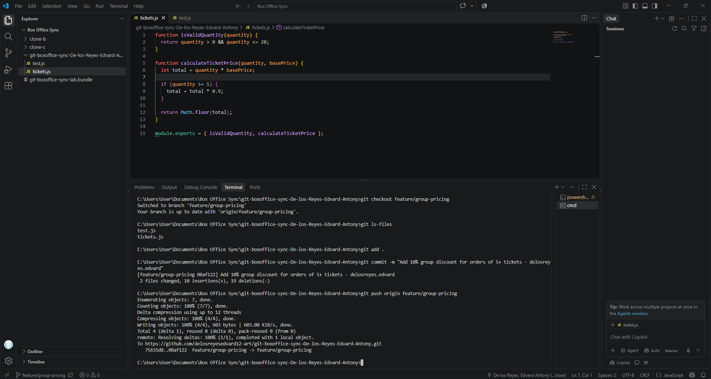
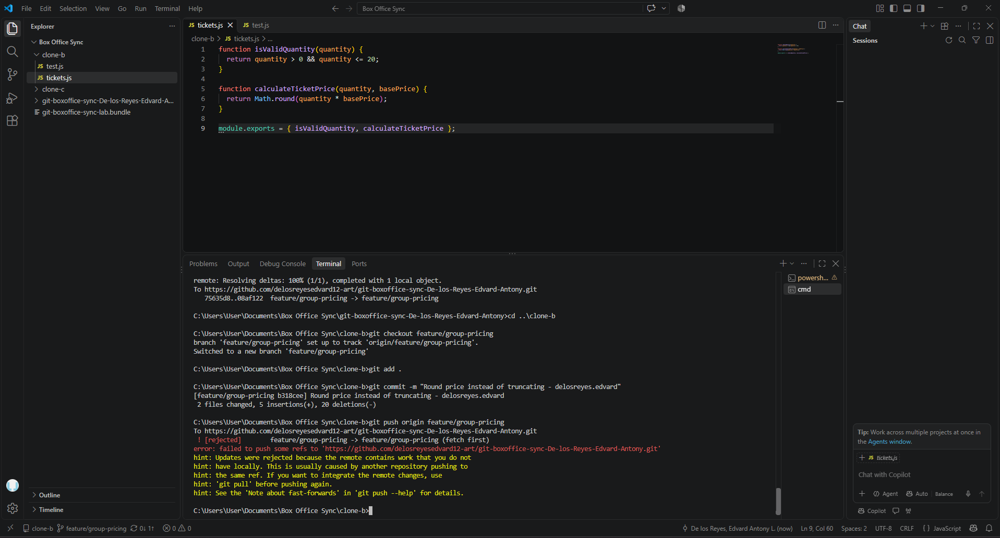
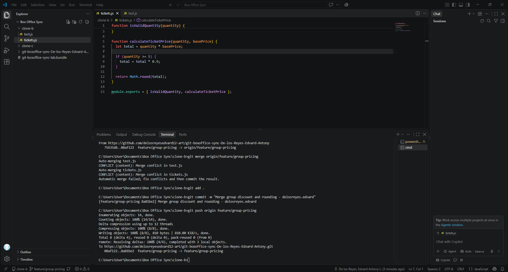
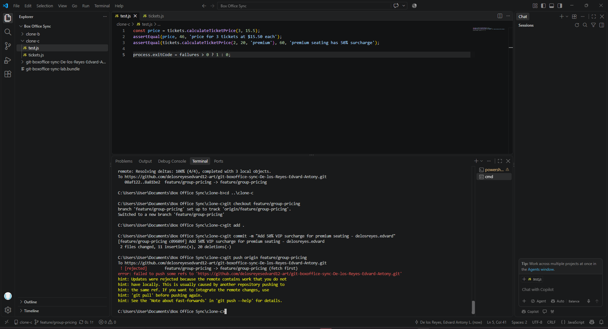
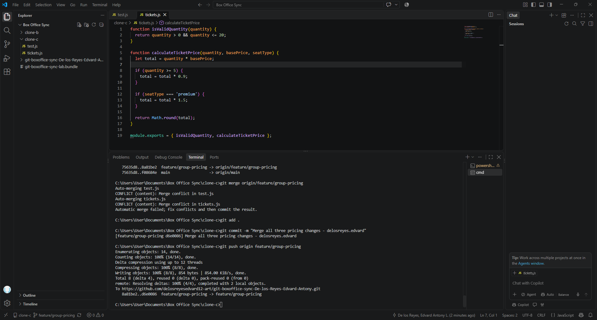
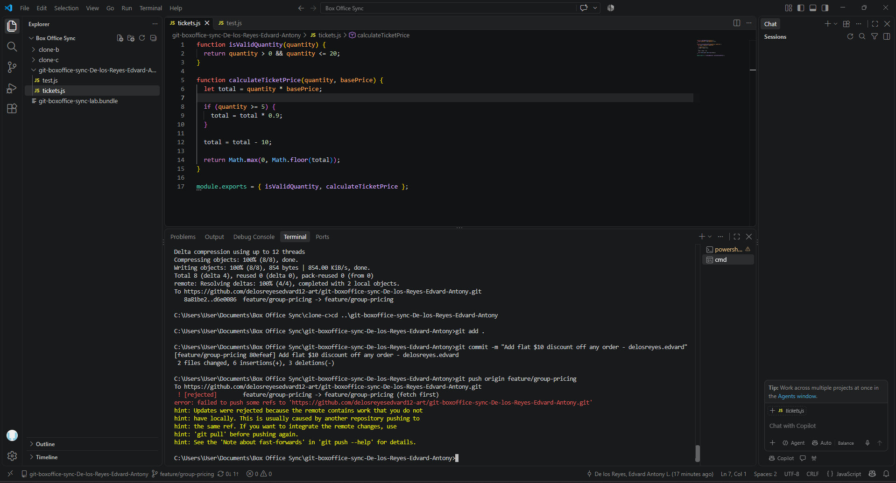
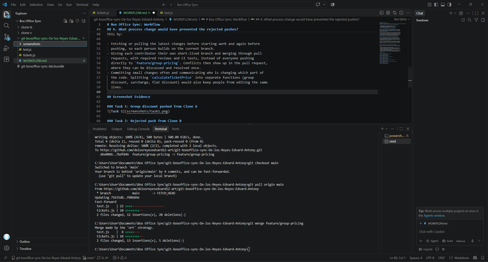

# Box Office Sync: Workflow

**Name:** Edvard Antony De los Reyes
**Repository:** https://github.com/delosreyesedvard12-art/git-boxoffice-sync-De-los-Reyes-Edvard-Antony

## 1. Who is responsible for each part of the final calculateTicketPrice?

- **Group discount (10% off 5+ tickets):** Clone A, Task 1
- **Rounding (Math.round instead of Math.floor):** Clone B, Task 2
- **VIP surcharge and the seatType parameter:** Clone C, Task 4
- **Flat $10 discount and Math.max(0, ...):** Clone A, Task 6

## 2. Task 3's two-way conflict vs Task 5's three-way conflict

Task 3 was a two-way conflict. Clone B's rounding change collided with Clone A's
group discount in `calculateTicketPrice`, mainly on the `return` line, where one
side used `Math.floor(total)` and the other used `Math.round(...)`. I only had to
combine two changes, so the fix was to calculate `total` with the discount and
then return `Math.round(total)`.

Task 5 was harder because the incoming branch already contained two people's work
(the group discount and the rounding), while Clone C had changed the same function
for the VIP surcharge. Three contributors' changes touched the same function, and
I had to understand all three intents at once. The hardest part was the function
body and `return` line, because it was edited by every contributor, and the
`seatType` parameter had to be added without breaking the other logic. I also had
to merge the tests so that all of them agreed with the combined behavior.

## 3. Why did Task 6's $10 discount break tests unrelated to my change?

The flat $10 discount applies to every order, so it changes the final price in
every case. The existing tests check the final price returned by one shared
function, so each expected value had to change: the 3-ticket test went from 47 to
37, the rounding test from 21 to 11, the group discount test from 45 to 35, and
the premium test from 60 to 50. None of those tests was about the $10 discount,
but they all depend on the same calculation.

This shows that "isolated" changes are not really isolated when all the pricing
rules live in one function and the tests only check the final total. A change to
one rule shifts the result of every other rule's test. The tests are coupled to
the order and combination of all the rules, not just to the rule they are named
after.

## 4. What process change would have prevented the rejected pushes?

All three contributors were pushing to the same branch without syncing, so each
push was rejected because the remote had moved ahead. A real team could prevent
this by:

- Fetching or pulling the latest changes before starting work and again before
  pushing, so each person builds on the current branch.
- Giving each contributor their own short-lived branch and merging through pull
  requests, with required reviews and CI tests, instead of everyone pushing
  directly to `feature/group-pricing`. Conflicts then show up in the pull request,
  where they can be discussed and resolved once.
- Committing small changes often and communicating who is changing which part of
  the code. Splitting `calculateTicketPrice` into separate functions (group
  discount, surcharge, flat discount) would also keep people from editing the same
  lines.

## Screenshot Evidence

### Task 1: Group discount pushed from Clone A

### Task 2: Rejected push from Clone B

### Task 3: Merge resolved and pushed from Clone B

### Task 4: Rejected push from Clone C

### Task 5: Three-way merge resolved and pushed from Clone C

### Task 6: Rejected push, rebase, and successful push from Clone A

### Task 7: Merge into main and tag
